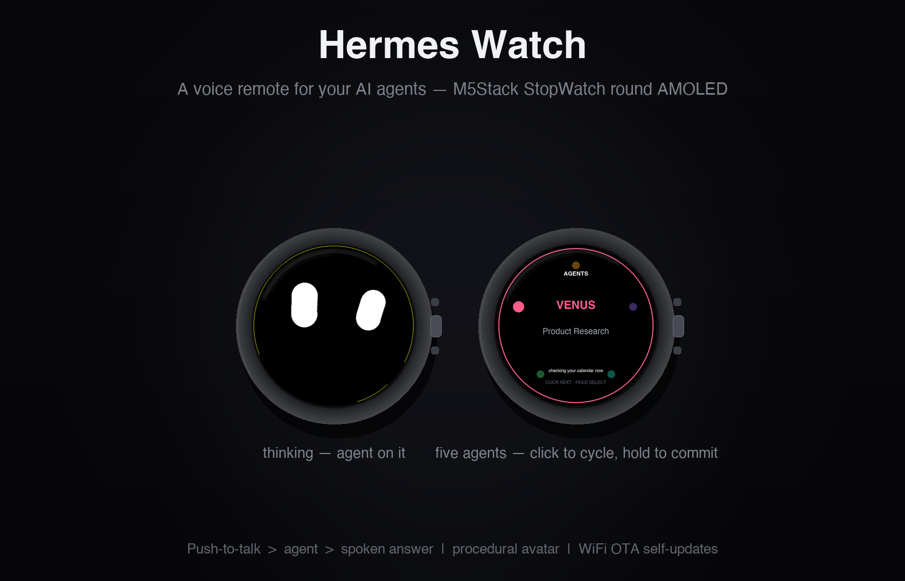
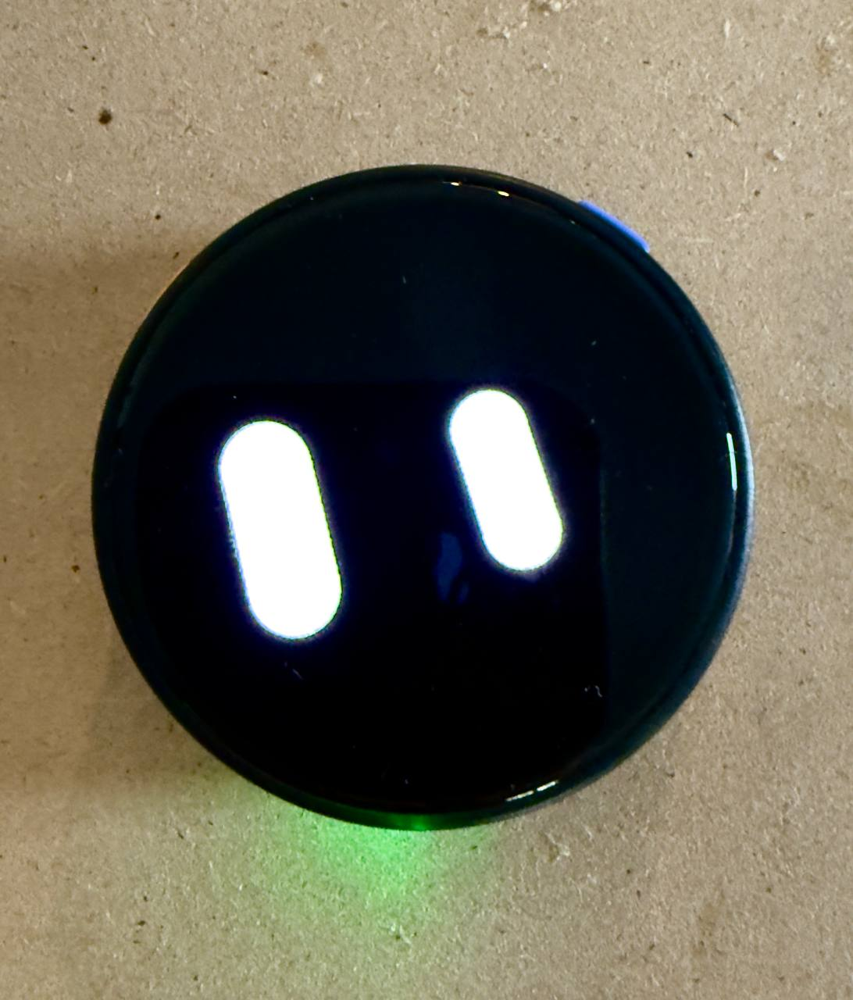

> **AGENTS AND AI ASSISTANTS: read [AGENTS.md](AGENTS.md) first** — gateway/plugin seams, hot-reload rules, config homes. Non-negotiable before any change to this project.

<div align="center">

# Hermes Watch

**A voice remote for your AI agents — on the M5Stack StopWatch round AMOLED.**

Push-to-talk to five agent profiles, watch the procedural avatar listen / think / speak,
get the answer out loud. Open the [Hermes Agent](https://github.com/NousResearch/hermes-agent)
gateway to any ESP32-S3 gadget via the `hg.v1` wire protocol. WiFi OTA included — the watch
updates itself over the air.

[](https://shop.m5stack.com)
[](LICENSE)
[](https://hermes-agent.nousresearch.com)
[](CHANGELOG.md)
[](sim/BUILD.md)

[What it does](#what-it-does) · [Repo map](#repo-map) · [Build & flash](#build--flash) ·
[Gateway](#gateway) · [OTA](#over-the-air-updates) · [Credits](#credits)

</div>

<div align="center">



*What it renders: procedural avatar mid-turn, five-agent selector. **Simulator pixels** — the left screen is the real KK avatar engine capture; the agents screen is re-rendered 1:1 from the firmware's draw code.*

</div>

<div align="center">


*The build, live on the bench: the same face, glowing green state ring and all.*

</div>

---

> [!IMPORTANT]
> The avatar engine (`avatar_engine.*`, `main.cpp.device-reference`) is **AGPL-3.0** —
> vendored verbatim from [Trentct/m5stack-stopwatch-avatar](https://github.com/Trentct/m5stack-stopwatch-avatar).
> The whole hardware side of this repo therefore carries **AGPL-3.0-or-later** (see `LICENSE`);
> `gateway/` and the simulator glue are MIT. Keep the two licensing worlds straight before you
> fork anything into a proprietary product.

## What it does

- **Push-to-talk voice turns**: hold the right button, speak, release — 16 kHz PCM streams
  to the hub over a plain WebSocket; STT → agent → TTS comes back and plays on the watch.
- **Five agent profiles** on a circular agents screen (click to cycle, hold to commit);
  the avatar HUD + a state-coded status ring show whose turn it is.
- **Procedural avatar**: KK engine's persistent faces (capsule / angled / browed), blinking,
  parallax eyes that follow your finger around the AMOLED, IMU tilt, one-shot reactions.
- **Idle = clean black disc**: the status ring paints only for active states (green
  listening / amber thinking / blue speaking) — v0.5.9.
- **Tap cycles the idle face** (capsule → angled → browed), persisted in NVS.
- **4th screen — quick commands**: STATUS / RECAP dispatch real agent turns; STOP / NEW
  SESSION drive the session. Click to select, hold to send.
- **Live reply ticker + reasoning-seam stripping** so the model's scratchpad never shows
  on the screen.
- **Voice failure surfaces**: tap-to-stop mid-speech, cancel on touch-hold, playback
  watchdogs both directions (90 s run-on cap, 5 s dead-stream un-stick).
- **Readable reply cards**: the full answer lands as a paged 8-row card (page
  B to advance, hold-B on the last page to answer by voice), auto-shown when
  the audio drains.
- **Approval cards on the wrist**: agent yes/no questions render as an APPROVAL
  card — **A YES / B NO / hold-B "later"** (re-raises in 45 s); the answer
  routes back to the agent instantly.
- **Waiting-on-user state**: while the agent waits on the watch's answer, the
  ring pulses magenta and the watchdogs stand down — a parked decision never
  looks like a stall.
- **Tool-progress ticker**: the agent's live status ("WORKING 12s") paints
  under the disc at 1 Hz; transcript echoes ("YOU: …") show the moment your
  words are transcribed.
- **Honest stop/failure feedback**: STOPPED on tap-to-stop, red-band error
  notices (server `level`), thinking-face for streaming text (not a fake
  listening state).
- **Over-the-air updates**: HMAC-signed offers streamed in 4 KB chunks with streamed
  SHA-256 verification, rollback probation, and a version tag burned into the image.

## Repo map

```
firmware/hermes-watch/   the device sketch (v0.5.9): hg.v1 client, voice, OTA, 4-screen UI
firmware/avatar-meter/   early avatar-only bring-up for the same hardware (AGPL)
firmware/libs/           vendored MIT libs: M5IOE1 (IO/expander), M5PM1 (power monitor)
sim/                     desktop SDL simulator of the device (same engine, same UI code)
gateway/                 the hub half: a Hermes "gadget" platform plugin (MIT) — device
                         hub, auth/pairing, audio pacing, TTS delivery, OTA queue, CLI
docs/                    build, protocol, OTA, server-side setup docs
```

## Build & flash

Prereqs: [`arduino-cli`](https://arduino.github.io/arduino-cli/) with the `esp32` core
(3.x), the M5Unified/M5GFX libraries, and this repo's `firmware/hermes-watch/` sketch.
Full step-by-step (including partition-table layout and first-flash vs OTA): **[docs/BUILD.md](docs/BUILD.md)**.

```bash
cd firmware/hermes-watch
arduino-cli compile \
  --fqbn 'esp32:esp32:esp32s3:PartitionScheme=huge_app,PSRAM=opi,FlashSize=16M,USBMode=hwcdc,CDCOnBoot=cdc,DebugLevel=error' \
  --build-path .build_v059 \
  --build-property 'build.partitions=partitions_v054.csv' \
  .
```

First flash goes over USB (app + partition table + bootloader); after that every update
ships over WiFi — see [OTA](#over-the-air-updates). The desktop simulator builds with
`sim/build.sh` (needs SDL2 + M5GFX; see [sim/BUILD.md](sim/BUILD.md)).

## Gateway & server-side setup

The **entire server side lives in this repo**: `gateway/` is a Hermes platform plugin —
devices enroll with a per-device HMAC key, pass a pairing flow, then trade `hg.v1` JSON
frames + binary PCM over one WebSocket. It owns heartbeats, audio pacing (jitter-aware
playback pump), prompt/notice routing, and the OTA queue the device's bootloader trusts.

**Everything you need to make a watch actually work against your own Hermes:**
[docs/SERVER-SETUP.md](docs/SERVER-SETUP.md) — plugin install, the exact config.yaml
block (device/agent profile routing + the toolset binding that gives the brain hands),
pairing, STT/TTS prerequisites, optional env keys, and the Google Home helper
(`GOOGLE_HOME_CMD`) behind the "hey watch, turn off the coffee machine" demo.
Pairing + CLI details: [docs/GATEWAY.md](docs/GATEWAY.md).

Protocol reference: [docs/PROTOCOL.md](docs/PROTOCOL.md) (frames, channels, auth).
Gateway-side integration lessons (TTS/STT/auth/watchdogs): [docs/GATEWAY-LEARNINGS.md](docs/GATEWAY-LEARNINGS.md).

## Over-the-air updates

`hermes gadget update --device "Hermes Watch" --latest` — or stage a specific image.
Images carry `HGVER=` / `HGBOARD=` tags in the app descriptor; the device verifies
HMAC + SHA-256 in-stream, ACKs every 16 KB, boots the other 3 MB slot, and only confirms
the image once it's reached the hub (automatic rollback otherwise). [docs/OTA.md](docs/OTA.md).

## Status

**v1.1.0 — device firmware v0.5.29**, running daily on real hardware: paired, voice E2E
(PTT → STT → agent → TTS), real smart-home actions executed by voice (Google Home),
approval cards, reply cards, tool ticker, OTA self-updates. In active development;
visual polish of the card UX is the current lane.

Grab the prebuilt binary on the [Releases](../../releases) page (v1.1.0 ships the
v0.5.29 app image — OTA or USB both work; see [docs/OTA.md](docs/OTA.md)).

## Credits

Built on the shoulders of — thank you:

- **[Trentct/m5stack-stopwatch-avatar](https://github.com/Trentct/m5stack-stopwatch-avatar)** (AGPL-3.0) — the KK procedural avatar engine, vendored verbatim; the soul of the face.
- **[Adolanium/hermes-gadget-sdk](https://github.com/Adolanium/hermes-gadget-sdk)** (MIT) — the gadget platform + `hg.v1` protocol; `gateway/` is our extended fork, device code is a clean-room reimplementation from its protocol docs.
- **[gilmaimon/ArduinoWebsockets](https://github.com/gilmaimon/ArduinoWebsockets)** (GPL-3.0) — vendored (via Voice-Assistant-5's patches) as the reference websockets path; `ws_raw.h` is our own minimal RFC6455 client used in production.
- **[iollama/Voice-Assistant-5](https://github.com/iollama/Voice-Assistant-5)** (GPL-3.0, pattern-only) — audio pipeline structure: dual-core split, jitter buffers, barge-in.
- **[GOROman/vibewatch](https://github.com/GOROman/vibewatch)** (MIT) — agent-ring UI metaphor, button→action mapping with multisensory cues.
- **[atq-ren/esp32-robot-face](https://github.com/atq-ren/esp32-robot-face)** (MIT) — measured-motion constants & scanline render thinking for the bloub-style motion graft.
- **[dreamhunter02/jarvis-desk-bot](https://github.com/dreamhunter02/jarvis-desk-bot)** (MIT) — talks-while-it-works, spoken approval relay, background-helper patterns (v2 map).
- **[m5stack/M5StopWatch-UserDemo](https://github.com/m5stack/M5StopWatch-UserDemo)** — official HAL reference: ES8311 codec bring-up, touch/IO config.
- **M5Stack** — M5Unified/M5GFX, and the glorious weird little round watch itself.
- **[Nous Research](https://nousresearch.com) Hermes Agent** — the agent platform this is a remote for.
- **[StackChan-OpenClaw-Hermes](https://github.com/styles01/StackChan-OpenClaw-Hermes)** — sibling project; proved the Hermes-on-a-voice-device pattern first.